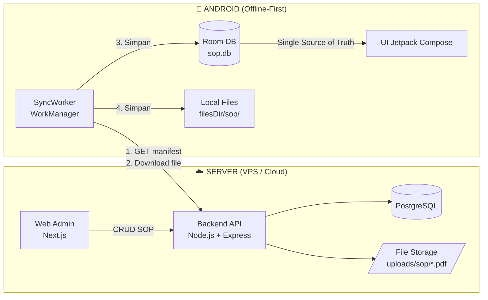

# e-SOP Sawit 🌴

**Aplikasi Media SOP / Instruksi Kerja Digital untuk Perusahaan Perkebunan Kelapa Sawit**

Sistem monorepo yang terdiri dari 3 aplikasi: **Android (Kotlin Native)**, **Web Admin (Next.js)**, dan **Backend API (Node.js + Prisma)**. Dibangun dengan strategi **offline-first** — SOP yang sudah diunduh tetap bisa dibaca di kebun meskipun tidak ada sinyal.

> ## 🌐 Tidak punya Android Studio / Node.js di PC?
> Semuanya bisa dibangun **100% lewat browser**: upload kode via GitHub, APK dibangun GitHub Actions, backend di Render, database di Neon, web admin di Vercel.
> **→ Ikuti [Panduan 100% Online](docs/panduan-100-online.md)** (±1 jam, biaya Rp0 untuk pilot).

---

## 📱 Fitur Utama

| Fitur | Keterangan |
|-------|------------|
| 📄 SOP Digital (PDF) | SOP Panen (cut & keep), Pemupukan, Spraying, Irigasi, QM, K3 dalam bentuk dokumen PDF |
| 🔄 Update dari Backend | Aplikasi Android menarik versi terbaru SOP otomatis dari server (manifest + versi + checksum) |
| 📥 Mode Offline | SOP yang telah diunduh tersimpan di database lokal (Room) & storage internal, dapat dibaca tanpa internet |
| 🔐 Multi-level Role | Superadmin → Manager/AED → Asisten → Mandor/Kru → Pekerja |
| ✅ Versioning | Setiap perubahan SOP menaikkan nomor versi; perangkat mendeteksi perbedaan versi via checksum SHA-256 |
| 📊 Log Sinkronisasi | Server mencatat kapan setiap perangkat mengunduh SOP |

---

## 🗂️ Struktur Monorepo

```
sop-sawit/
├── apps/
│   ├── android/          # Aplikasi Android — Kotlin, Jetpack Compose, Room, Retrofit, WorkManager
│   └── web/              # Dashboard Admin — Next.js 14, Tailwind CSS
├── backend/              # REST API — Node.js, Express, Prisma ORM, PostgreSQL, JWT
├── docs/                 # Dokumentasi arsitektur, API spec, panduan setup
├── scripts/              # Skrip bantu (migrasi, seed, deployment)
└── .github/workflows/    # CI/CD GitHub Actions (3 pipeline otomatis)
```

## 🏗️ Arsitektur Singkat



**Alur sinkronisasi offline-first:**
1. Admin unggah / revisi SOP lewat **Web Admin** → backend menaikkan `version` & menghitung `checksum` SHA-256.
2. Aplikasi Android menjalankan **SyncWorker** (WorkManager, periodik tiap 6 jam + manual refresh).
3. Worker memanggil `GET /api/sync/manifest?since=lastSyncAt` → membandingkan versi & checksum dengan data lokal (Room).
4. SOP yang berbeda versi diunduh dari `GET /api/sync/files/:id` → disimpan ke storage internal + Room DB.
5. UI **selalu membaca Room DB** → seluruh fitur tetap berjalan 100% offline.

---

## 🚀 Mulai Cepat

> 💡 **Tanpa install Node.js/Android Studio di PC?** Lewati bagian ini dan ikuti
> **[Panduan 100% Online](docs/panduan-100-online.md)** — semua lewat browser
> (GitHub Actions untuk APK, Render + Neon untuk API, Vercel untuk web admin).

### Prasyarat
- Node.js ≥ 20, PostgreSQL ≥ 15
- Android Studio (Kotlin ≥ 2.0, JDK 17), atau VS Code untuk web

### 1. Backend
```bash
cd backend
cp .env.example .env                  # sesuaikan DATABASE_URL & JWT_SECRET
npm install
npx prisma migrate dev --name init    # buat tabel di PostgreSQL
npx prisma db seed                    # data awal: user admin + kategori SOP
npm run dev                           # http://localhost:3001/api/health
```

### 2. Web Admin
```bash
cd apps/web
cp .env.example .env.local            # isi NEXT_PUBLIC_API_URL
npm install
npm run dev                           # http://localhost:3000
```
Login awal: `admin` / `admin123` (wajib diganti setelah deploy).

### 3. Android
Buka folder `apps/android` di Android Studio → sinkronkan Gradle → atur `BASE_URL` di **`gradle.properties`** (dibaca otomatis saat build) → Run.

---

## 🐙 Panduan Push ke GitHub

**Cara tercepat** — buat repo kosong di [github.com/new](https://github.com/new) (Private, tanpa README/license), lalu:

```bash
cd sop-sawit
chmod +x scripts/*.sh
./scripts/init-git.sh <username-github>
```

Skrip otomatis: `git init` → cek tidak ada `.env` bocor → commit awal → remote → push `main`.

<details>
<summary>Cara manual</summary>

```bash
cd sop-sawit
git init -b main
git add .
git commit -m "feat: struktur awal monorepo e-SOP Sawit"

# Buat repo baru di GitHub (butuh GitHub CLI, atau buat manual di github.com/new)
gh repo create sop-sawit --private --source=. --push

# Atau cara manual:
git remote add origin https://github.com/<username>/sop-sawit.git
git branch -M main
git push -u origin main
```

</details>

Panduan lengkap (branch strategy, release APK via GitHub Actions, deployment VPS): lihat **[docs/panduan-setup.md](docs/panduan-setup.md)**.

## 📚 Dokumentasi

- **[Panduan 100% Online](docs/panduan-100-online.md)** — bangun & jalankan semuanya lewat browser, tanpa install apa pun
- [Dokumen Arsitektur](docs/arsitektur.md) — komponen sistem, desain database, strategi offline
- [Spesifikasi API](docs/api-spec.md) — daftar seluruh endpoint + contoh request/response
- [Panduan Setup](docs/panduan-setup.md) — setup GitHub, CI/CD, deployment VPS/Docker
- [Panduan Kontribusi](CONTRIBUTING.md) — alur branch, gaya commit, aturan PR
- [Kebijakan Keamanan](SECURITY.md) — cara melaporkan celah keamanan + checklist deploy
- [Lisensi](LICENSE) — penggunaan internal perusahaan

## 🛡️ Role & Hak Akses

| Role | Web Admin | Android | Keterangan |
|------|-----------|---------|------------|
| SUPERADMIN | ✅ Penuh | ✅ Baca | Kelola user, kategori, SOP semua unit |
| MANAGER (AED) | ✅ Kelola SOP | ✅ Baca | Persetujuan & publikasi SOP |
| ASSISTANT (Asisten) | ✅ Kelola SOP | ✅ Baca | Input & revisi SOP divisi |
| FOREMAN (Mandor/Kru) | ❌ | ✅ Baca + Sync | Baca SOP, terima notifikasi update |
| WORKER (Pekerja) | ❌ | ✅ Baca + Sync | Baca SOP yang dipublikasikan |

---

Dibangun dengan ❤️ untuk produktivitas perkebunan sawit Indonesia.
